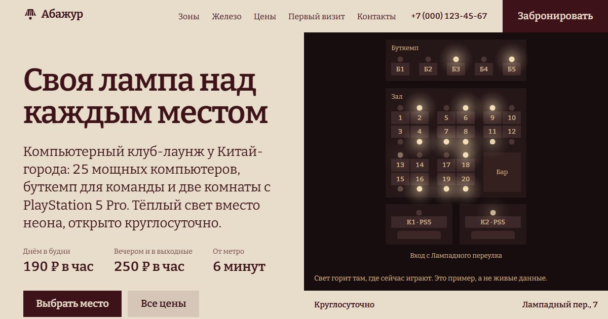

# «Абажур»: сайт компьютерного клуба-лаунжа (демо для портфолио)

Сайт вымышленного компьютерного клуба в центре Москвы. Клуба не существует, бронь никуда не отправляется, и сайт говорит об этом прямо.



## Идея

Над каждым местом в клубе висит своя лампа с тканевым абажуром: вместо неона и общего света под потолком. Эта лампа — главный образ сайта:

- **Половина экрана не двигается.** На десктопе справа всегда виден «зал»: план клуба ночью. При загрузке лампы загораются волной, потом гаснут свободные места и остаются гореть занятые. Пока вы читаете, картинка сменяется под раздел: план, клавиатура, лампа, комната. На вкладках зон план приглушает всё, кроме выбранной зоны. Курсор мыши над планом тоже светит, как лампа в руке.
- **Бронь на том же плане.** Каждая лампа на нём — чекбокс. Отмечаете места, лампы загораются, цена считается сразу, с пакетами, если так дешевле.
- Железо подано как меню с отрывным краем, первый визит — как чек.

## Что внутри

- Первый экран: что это, сколько стоит (190 ₽/ч днём в будни, 250 ₽/ч вечером), где находится, кнопки «Выбрать место» и «Все цены».
- Зоны: зал на 20 мест, буткемп на пятерых, две комнаты с PS5 Pro. Вкладки со стрелками на клавиатуре, без JS все зоны видны списком.
- Железо простыми словами: что даёт RTX 5070, зачем 240 Гц.
- Цены и пакеты (3 часа, 5 часов, ночь).
- «Первый раз в клубе?»: путь от двери до игры по минутам.
- Бронь: день, время, длительность, места на плане, имя, телефон, согласие. Занятость мест — пример, детерминированный по дню и часу, и подписан как пример. Одна зона на бронь (цены разные), ночной пакет недоступен для комнат с PS5 (они до 04:00). Ошибки у полей и общий список со ссылками. После отправки — экран «Бронь собрана» с честной пометкой.
- Галерея (лента с перетаскиванием), вопросы новичков текстом без аккордеона, контакты, подвал. Мобильная панель «от 190 ₽ в час · Выбрать место».
- Страницы 404 и «Политика конфиденциальности».

## Запуск

```sh
npm install
npm run dev          # http://localhost:4321
npm run build        # astro check + статическая сборка в dist/
npm run preview      # собранный сайт с настоящей CSP
npm test             # юнит-тесты, сборка, e2e (Playwright, Edge на Windows)
```

На других системах для e2e нужен `npx playwright install chromium`, либо канал браузера задаётся через `PW_CHANNEL`.

## Демо-данные: что заменить

| Что | Где |
|---|---|
| Название, адрес, часы, телефон, почта, зоны и цены, железо, первый визит, FAQ | `src/data/club.ts` |
| Пакеты и расчёт стоимости, правила брони | `src/data/club.ts` → `packages`, `src/lib/pricing.ts` (покрыто `tests/unit/pricing.test.ts`) |
| Пример занятости мест | `takenSeats` в `src/lib/pricing.ts` |
| Фото и авторы | `src/data/photos.ts`, файлы в `src/assets/photos/`, обработка `scripts/photos.py` |

Телефон `+7 (000) …` не выдан ни одному оператору, домен почты `.example` зарезервирован, Лампадного переулка в Москве нет. Цены сверены между собой: пакет применяется, только если он дешевле почасовой оплаты.

## Настоящая бронь

Сейчас форма ничего не отправляет. Для рабочей версии:

1. Занятость мест брать из системы управления клубом (у клубов это обычно Langame, SENET, iCafeCloud или своя) через их API, вместо `takenSeats`.
2. В обработчике `submit` в `src/components/home/Booking.astro` есть отмеченное место: отправить `POST` на свой сервер, который создаст бронь и пришлёт SMS. Токены API держать только на сервере.
3. Добавить адрес сервера в `connect-src` в `astro.config.mjs`.
4. Переписать экран «Бронь собрана» и `/privacy/`: оператор данных, срок хранения, отзыв согласия (152-ФЗ).

## Технологии

- Astro 7, статическая сборка, TypeScript strict, без UI-фреймворка.
- Motion 14 (`motion/mini`, WAAPI): появление блоков, реакции на действия. Вступление первого экрана сделано на CSS, чтобы заголовок не зависел от скрипта. Anime.js не понадобился: одной библиотеки хватило.
- Bitter (вариативный, с кириллицей) с собственного хостинга, один шрифт на весь сайт.
- Строгий CSP в meta-теге, сторонних запросов нет.
- Фото в AVIF и WebP нужных размеров, ниже первого экрана грузятся лениво.

## Проверено

- `npm run build`: 0 ошибок типов.
- 5 юнит-тестов расчёта и проверки формы, 20 e2e (10 сценариев × десктоп и Pixel 7): SEO-основа и чистая консоль, нет горизонтальной прокрутки от 320 до 1920 px, axe WCAG 2.2 AA без серьёзных нарушений, якоря, вкладки зон с клавиатуры, бронь целиком (ошибки, места, пакет, смена зоны, демо-подтверждение, ничего не пишется в хранилище), мобильное меню, reduced motion, 404, robots, sitemap, только свои запросы.
- Замер на медленном 4G и CPU ×4: LCP 1,9 с на десктопе и 1,75 с на телефоне, CLS 0,033, первая загрузка около 190 КБ, весь JS 44 КБ.

## Лицензии

Код: MIT. Фото с [Unsplash](https://unsplash.com) по лицензии Unsplash, приглушены одним тёплым фильтром (`scripts/photos.py`), авторы перечислены в подвале сайта и в `src/data/photos.ts`. На фото другие клубы и вещи, сайт подписывает их как иллюстративные. Bitter: SIL OFL 1.1. Motion, Astro: MIT.
